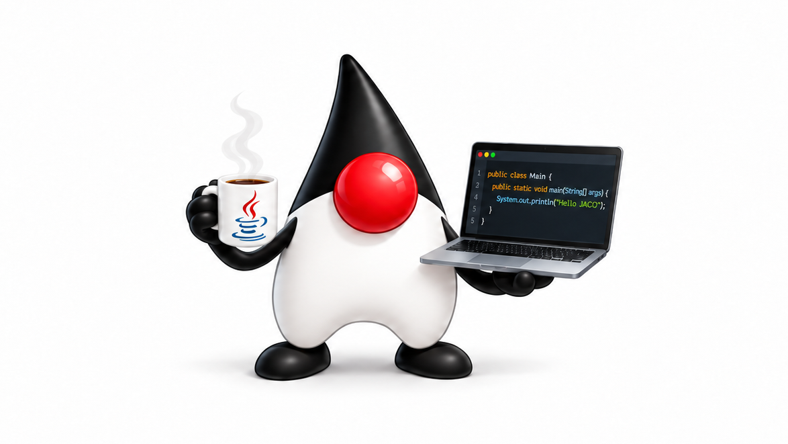

<p align="center">
  
</p>

<h1 align="center">JACO</h1>

<p align="center"><em>JAVA CODER</em></p>

<p align="center">用 Java 21 从零构建的终端 AI 编程助手</p>

> JACO 将模型对话、工具调用和权限确认串成完整的 agent 循环。 你可以在终端中让它阅读代码、修改文件、执行命令，或委派只读子 agent 调查问题。模型通过 OpenAI 兼容的 Chat Completions 接口接入，核心 agent 与终端界面独立，便于扩展工具和交互方式。

## 功能概览

- **终端交互**：流式输出、等待动画、Markdown 渲染、代码高亮与中文表格对齐。
- **工具调用**：读写文件、浏览目录、搜索代码、执行命令、检索归档与委派子任务。
- **权限控制**：只读工具自动放行，写入、命令执行和子任务需确认；支持按工具在当前会话内放行。
- **会话管理**：自动保存和恢复会话，支持查看历史、切换会话与中断当前任务。
- **上下文管理**：大工具输出自动归档，长对话分层压缩，保留可检索的原始历史。

## 快速开始

直接运行release目录下的jar包，需要 **JDK 21 或更高版本：**
> java -jar .\release\jaco.jar

**也可以选择自己构建，步骤如下：**
### 1. 构建

需要 **JDK 21 或更高版本**和 **Maven**。在项目根目录执行：

```bash
mvn package
```

构建后生成包含运行依赖的 `target/jaco.jar`。

### 2. 配置模型

首次执行以下命令会输出配置示例；请手动创建 `~/.jaco/config.yaml`，然后重新启动：

```bash
java -jar target/jaco.jar
```

Windows 下默认配置路径为 `%USERPROFILE%\.jaco\config.yaml`。设置 `JACO_HOME` 可以更改配置、会话和日志所在的数据目录。

以 DeepSeek 为例：

```yaml
active: deepseek
providers:
  deepseek:
    base_url: https://api.deepseek.com
    api_key: ${DEEPSEEK_API_KEY}
    model: deepseek-chat
    temperature: 0.7
```

可以直接在配置文件中配置 API Key 或者在启动 JACO 的终端中设置 API Key。

**PowerShell：**

```powershell
$env:DEEPSEEK_API_KEY = "你的 API Key"
```

**Bash / Zsh：**

```bash
export DEEPSEEK_API_KEY="你的 API Key"
```

### 3. 开始对话

```bash
java -jar target/jaco.jar
```

**启动时所在的目录就是工作目录。** 如需操作其他项目，先进入目标目录，再使用 JAR 的绝对路径启动：

```bash
cd /path/to/your-project
java -jar /path/to/jaco/target/jaco.jar
```

进入交互界面后，直接输入任务，例如：

```text
帮我梳理这个项目的结构，并说明入口和核心模块。
检查配置加载逻辑，找出可能导致启动失败的原因。
帮我修改这个方法，并运行相关测试。
```

## 交互与权限

### 命令与快捷键

| 命令 / 快捷键 | 作用 |
| --- | --- |
| `/help` | 显示可用命令 |
| `/new` | 创建新会话，清空当前上下文与权限放行记录 |
| `/sessions` | 按新到旧列出会话 ID、标题和消息数，`*` 标记当前会话 |
| `/switch <会话 ID>` | 切换会话并清空权限放行记录，支持唯一 ID 前缀 |
| `/delete <会话 ID>` | 删除历史会话及归档，支持唯一 ID 前缀；需确认，不能删除当前会话 |
| `/memory` | 查看用户画像、条目 ID、类别和作用范围 |
| `/memory forget <ID>` | 删除指定画像条目，使用完整 ID |
| `/memory clear` | 确认后清空全部画像，包含所有项目 |
| `/memory off` / `/memory on` | 关闭 / 开启自动记忆与画像加载，设置随画像持久保存 |
| `/exit` 或 `Ctrl+D` | 退出 |
| `Ctrl+C` | 中断当前轮：取消模型流、终止命令子进程、拒绝待确认操作；已生成内容保留进会话 |

启动时自动恢复最近一次会话；没有历史会话时创建新会话。

会话标题自动取首次有效用户输入的前 40 个字符，合并空白并在超长时添加省略号，无需额外请求模型。标题随会话保存，后续输入和上下文压缩不改变标题；旧会话从尚存的首条用户消息提取标题，无有效输入时显示“未命名会话”。切换会话仍使用 ID。

`/delete` 会展示目标 ID 和标题，输入 `y` 后删除对应会话 JSON 和归档 JSONL，操作不可恢复；其他输入、`Ctrl+C` 或 `Ctrl+D` 均取消。删除当前会话前，请先 `/switch` 或 `/new`；前缀不唯一时不会删除，也不支持批量删除。

新建会话或成功切换到其他会话后，需要重新确认工具授权；切回旧会话不会恢复此前授权。切换失败或切换到当前会话时，现有授权保持不变。

### 跨会话用户画像

用户画像默认开启，独立于会话保存。每轮以 `stop` 正常完成后，根据本地规则决定提取时机：明确表达（如“以后默认中文”“我是 Java 开发者”“忘记我的职业”）立即提取；普通消息先加入持久队列，当前项目累计 10 条时批量提取一次；“继续”“好的”“谢谢”等纯确认消息直接跳过。筛选规则只决定调用时机，是否构成长期信息仍由当前配置的模型判断。正常提取和更新静默执行，不显示进度或“已记住”条目；失败批次丢弃数量及错误类型仅写日志，无法保存批次清理结果时才显示简短提示。后续请求、新会话和重启后使用新画像。提取结果不进入会话消息，提取调用的 token 使用量计入触发它的对话或补处理操作的统计。

立即提取按本地意图规则判断，不把“默认”“以后”等单词本身作为触发条件，也不枚举职业名称。“长期表达 + 回复或工作行为”才触发偏好提取；自我介绍支持“我是一名……”“我从事……工作”等通用句式，裸“我是……”排除“我是来问问题的”“我是说这个方法”等明显任务表达。明确记住、忘记和个人信息纠正优先处理；直接的偏好请求问句仍可触发，自我信息查询不会仅因出现“我的职业”等词而触发。

| 用户表达 | 本地处理 |
| --- | --- |
| “这个参数默认是多少？”、“把接口超时默认值改成30秒” | `BATCH`，进入普通待处理队列 |
| “默认返回中文字符串”、“默认使用中文编码” | `BATCH`，避免将配置描述误作回复偏好 |
| “默认用中文回答我”、“以后能不能都用中文回复？” | `IMMEDIATE`，立即提取 |
| “这个项目以后统一用 Maven” | `IMMEDIATE`，模型判断是否为项目偏好 |
| “我是一名摄影师”、“我从事园艺工作” | `IMMEDIATE`，无需职业名单 |
| “记住我的称呼是小林”、“更正一下，我现在做产品设计” | `IMMEDIATE`，明确记忆或纠正请求 |
| “好的”、“继续” | `SKIP`，不入队 |

触发匹配前排除 Markdown 反引号/波浪线代码块、缩进代码、行内代码、`>` 引用及带明确说话来源的引号内容，保留“以后称呼我‘小林’”这类正常称呼。过滤仅作用于触发判断，普通含糊消息和引用原文仍可进入批量队列，最终语义判断和证据校验继续使用原始消息。本地规则可能漏选或误选，不保证理解所有自然语言表达；判断结果和原因码只记录在 DEBUG 日志，不增加模型分类调用，也不在正常回复中展示。规则及原因码集中在 [ProfileExtractionPolicy](src/main/java/com/jaco/memory/ProfileExtractionPolicy.java)。

画像只用于自然适配回答，回复守则要求模型在用户未主动询问时，不主动提及画像、记忆库或加载过程，也不列举用户信息或用“根据你的画像”等解释回答依据。用户主动询问已记住的信息或使用 `/memory` 时，可以查看相关内容；明确要求记住或忘记时可简短确认需求，但不宣称尚未实际完成的保存或删除。该回复约束通过系统提示词实现，最终措辞仍取决于模型遵循情况。

终端执行 `/new`、有效切换到其他会话或通过 `/exit` / Ctrl+D 退出时，补处理当前项目剩余消息。失败切换及切换当前会话不补处理。补处理可用 Ctrl+C 取消：新建或切换会话会取消，退出时仍可退出，队列保留。异常退出后尚未处理的队列恢复，之后达到批量阈值、出现明确表达或执行上述边界操作时继续处理，不在启动时自动请求模型。每个批次只尝试一次：网络失败、超时、输出不完整或校验失败都会直接丢弃本批，然后继续处理后面的批次，不设置冷却或重试。当前立即提取与普通批量提取共用队列，因此立即提取所在批次失败时也会丢弃，允许少量漏记。旧文件中的 `retryAfter` 字段被忽略，下一次写入时移除。

批次按用户发言顺序处理，操作必须携带具体消息 ID，原话证据只能来自该条消息；来源会话也由程序确定。成功提取（包括没有画像变化的空结果）在一次原子写入中保存画像并移除已处理消息。失败时不保存本批提取结果，单独原子移除本批候选，保留原画像、后续批次及其他项目的候选；用户取消时不移除消息。如果磁盘写入失败、无法保存丢弃结果，则保留内存状态并停止本次处理，避免反复处理同一批。不同项目不混在同一批次中；其他项目较早的候选也不能覆盖较新的全局偏好或重建已经自动删除的条目。

全局信息适用于所有项目；明确限定“这个项目”的偏好绑定当前工作目录的真实路径，同类别同键的项目偏好覆盖全局偏好。当前用户明确要求优先于已有画像；画像不能授予工具权限或跳过确认。切换会话和 `/new` 不清除画像，删除会话也不删除画像；画像中的来源会话 ID 因此可能指向已删除的会话。

聊天请求采用“固定常驻项 + 当前任务相关项”，通过本地规则选择，不额外调用模型。常驻项仅包括偏好类的 `response.language`、`response.length`、`response.tone` 和信息类的 `identity.preferred_name`；职业、技术背景、提交习惯等不会因最近更新而自动常驻。

| 当前任务 | 按需加载的画像键 |
| --- | --- |
| 提交代码、Git commit | `git.commit_style`、`git.commit_behavior` 和 `git.*` |
| Java / JavaScript / TypeScript 开发 | 对应的 `code.java.*` / `code.javascript.*` / `code.typescript.*`，以及通用代码偏好 |
| 修改代码、重构、运行测试 | 通用 `code.*`、`code.testing.*`、`identity.familiar_tech`；语言专属键只在对应语言命中时加载 |
| 编写文档、README | `document.*` |
| 明确询问自己的信息或偏好 | 个人信息及尚未映射的键，仍受总长度限制 |

当前用户原始输入决定任务类别，中文短语与英文标识符匹配可同时命中多个类别；英文匹配区分 Java 与 JavaScript。纯承接语（如“继续”“按刚才的方案做”）沿用上一轮任务类别，明确新任务或普通问候重新匹配；重启和切换会话从目标会话最近的实质用户输入恢复类别，`/new` 清空类别。助手回复和工具输出不参与任务识别。规则只做词语匹配，可能漏选或误选，扩展入口见 [ProfileContextSelector](src/main/java/com/jaco/memory/ProfileContextSelector.java)。

发送的画像使用简短的 `key: "value"` 行，只保留键与 JSON 字符串值，不发送 ID、类别、范围路径、证据或时间。选择顺序为常驻项、直接相关项、通用相关项，更新时间只用于同等相关性排序；先用当前项目值覆盖全局同键值，再选择条目。常见旧键名在加载和更新时归一化，例如 `reply.language` → `response.language`、`identity.name` → `identity.preferred_name`，无需手动改写旧画像文件。

提取器仅以队列中的用户原始消息为证据，每条消息之前的助手回复（最多 2,000 字符）只用于理解指代。模型被要求忽略引用、第三方信息、假设、角色扮演、临时要求（如“这次详细解释”）以及密码、密钥等凭据，不推断用户性格或身份。正式画像记录保存类别、稳定键、值、作用范围、来源会话、原话证据和更新时间；明确纠正用新值覆盖，明确要求忘记则删除。语义判断依赖当前模型，原文证据校验不能保证分类完全准确，发现误记可用 `/memory forget <ID>` 删除。

画像最多保存 64 条，每条值最多 240 字符，每批最多 16 个操作；超过容量时整批更新失败，保留原画像并丢弃本批候选。每次聊天请求注入的画像正文最多 2,000 字符，保留完整条目，不截断值。待处理队列最多 100 条、合计 100,000 字符（含每条助手上下文）；单条用户输入超过 16,000 字符或队列达到上限时，本条不入队并提示，已有队列保留。每批最多 10 条、合计 20,000 字符，长消息会拆成多批；立即提取和边界补处理可能因此需要多个请求，按顺序处理，失败批次丢弃后继续。画像提取每批共用 60 秒总预算，从请求前开始计时，连接、等待响应头、HTTP 重试及退避、错误正文读取和流式读取都消耗同一预算，重试和新内容片段不重置时间；本地结果校验和落盘不受此网络预算限制。超时会取消请求、关闭响应流并丢弃本批，用户 Ctrl+C 取消则保留批次。HTTP 客户端既有最多三次尝试策略保持不变，所有尝试均受总预算限制；普通聊天不使用画像提取的 60 秒截止时间。多个批次各自计算预算，补处理整个流程没有额外的总时长上限。提取失败不影响已经完成的聊天回复。提取仍携带全局和当前项目已有条目，以便识别更新和删除。

`/memory` 同时显示当前项目待处理消息数。`off` 停止额外提取调用与画像加载，保留正式画像，丢弃全部项目的待处理候选；`on` 恢复，不补录关闭期间的消息。手动 `forget` 成功删除条目或 `clear` 清空画像时，同样清理全部旧候选，避免以后批处理又记回被删除的信息。画像不会自动扫描旧会话，也不会因删除画像而抹去旧会话消息中的信息，当前会话仍可能提及这些信息；需要排除旧上下文时可再 `/new`。

画像和候选原始消息都在 `user-profile.json` 中以明文保存。候选消息尚未经过模型过滤，因此可能含原始输入中的个人信息或凭据；上述排除规则针对正式画像条目。提取时发送该批用户消息、对应助手上下文以及全局/当前项目的已有画像到当前模型服务，聊天时发送相关画像。旧画像文件无需手动迁移；文件损坏时本次启动停用画像并保留原文件，修复后重启。

### 内置工具

工具由模型根据任务调用，无需手动输入工具名。

| 工具 | 用途 | 默认权限 |
| --- | --- | --- |
| `read_file` | 流式读取 UTF-8 文件，带行号、完整文件版本及预算内分页，支持长行续读 | 自动放行 |
| `list_dir` | 浏览目录 | 自动放行 |
| `grep` | 搜索文件内容 | 自动放行 |
| `git_status` | 查看分支描述、暂存区、工作区和未跟踪文件状态 | 自动放行 |
| `git_diff` | 查看工作区或暂存区的补丁差异 | 自动放行 |
| `web_fetch` | 抓取公共网页、提取正文并从快照分页读取 | 新抓取需网络确认；快照分页自动放行 |
| `find_files` | 按文件名或相对路径 glob 定位文件 | 自动放行 |
| `recall` | 搜索当前会话归档、预览命中片段，按条目 ID 分页读取原文 | 自动放行 |
| `write_file` | 严格校验参数后，以 UTF-8 原子新建或覆盖文件 | 需确认 |
| `edit_file` | 单项或批量唯一匹配原文，支持保留换行风格，一次原子替换 | 需确认 |
| `run_command` | 执行非交互 shell 命令，支持启动目录、超时和输出编码 | 需确认 |
| `process_start` | 后台启动命令并返回任务 ID | 需确认 |
| `process_poll` | 列出当前会话后台任务，查询状态和增量日志 | 自动放行 |
| `process_stop` | 停止后台任务及已发现的子进程 | 需确认 |
| `task` | 委派具有独立上下文的只读子 agent，返回最终调查报告 | 需确认 |

确认提示支持：

| 输入 | 含义 |
| --- | --- |
| `y` | 仅允许本次调用 |
| `a` | 在当前会话内允许该工具的后续调用 |
| `n` | 拒绝调用，拒绝结果反馈给模型 |

`web_fetch` 的网络授权单独按源站管理：`a` 仅放行本会话中相同协议、主机和端口的初始抓取，不能放行其他源站。抓取会跟随经过地址校验的重定向，但不会因此授权将重定向目标作为后续请求的初始源站。只传 `fetch_id` 的分页读取不会联网，无需网络确认。新会话或成功切换会话会清除这些授权。

`run_command` 和 `process_start` 的命令命中危险命令黑名单时会直接拒绝，不能通过 `y` 或 `a` 放行。只读查询的文件名和路径不会按命令匹配黑名单。

`write_file` 接受 `path`、`content` 和 `expected_version`：路径必须是非空白字符串，内容必须显式提供字符串（空字符串表示空文件）。写入先在目标目录生成临时文件，完成后原子替换目标；失败时尝试清理临时文件。文件系统不支持原子替换时会报错，不降级为直接覆盖。已有文件的 POSIX 权限在支持的平台上保留。

`read_file` 流式扫描完整文件计算版本、统计行数，只保留当前页，文件上限 64 MiB。参数 `offset` 为起始行（从 1 开始），`limit` 为最多读取行数（默认 2000，上限 20000）；结果受工具字符预算限制。`has_more=true` 时，将 `next_line`、`next_column_offset` 分别作为下一次的 `offset`、`column_offset`，并携带本次返回的 `expected_version`，文件内容变化会拒绝续读。行内偏移从 0 开始、按 UTF-16 单位计算，不能切断 Unicode 代理对，只作用于起始行。长行通过游标完整续读，展示换行不代表原文件换行；CRLF/CR/LF 统一显示为换行，UTF-8 BOM 不显示但参与版本计算。严格拒绝非法 UTF-8、包含 NUL 的疑似二进制文件；支持取消，并检查读取前后的文件属性以发现并发变化（不提供操作系统级原子快照）。

修改已有文件优先使用 `edit_file`，单项参数为 `path`、`old_text`、`new_text` 和 `expected_version`；也可用 `edits: [{"old_text":"原文 A","new_text":"新文 A"},{"old_text":"原文 B","new_text":"新文 B"}]` 批量修改同一个文件，不能与顶层 `old_text/new_text` 混用。所有项在同一份原文中唯一定位，拒绝重叠（允许相邻），任意一项失败均不写入；统一预览并只执行一次原子替换。`old_text` 非空，不含 `read_file` 的行号；`new_text` 可为空表示删除。未找到时提示检查空白和换行，多处匹配时最多返回 8 个候选行号；不会自动选择匹配或进行模糊替换。不支持创建新文件。

`edit_file` 默认 `newline_mode="exact"`，空白、缩进和换行必须精确一致。可显式使用 `newline_mode="preserve"`：将 CRLF、CR、LF 视为相同换行进行唯一匹配，映射回原文位置，只对替换文本恢复文件原有换行风格，未修改内容及 BOM 保持不变。无换行的文件使用 LF；混合换行文件拒绝 preserve，需改用 exact；换行归一后出现多处匹配仍拒绝。此模式用于衔接 `read_file` 的换行归一显示，不忽略其他空白。

`edit_file` 最多 100 项，原文件及最终 UTF-8 文件均不超过 16 MiB；每个 `old_text/new_text` 的 UTF-8 字节数不超过 1 MiB，所有项输入文本合计不超过 4 MiB。拒绝非法 UTF-8 原文件、NUL 和无效 Unicode 输入。准备、生成预览、复核及写入期间检查取消；取消时不替换目标并清理临时文件。局部预览按已定位的修改区间及附近上下文生成，不对完整文件执行差异算法；同一原文行上的修改合并展示，长行尽量展示修改位置附近，最多 80 行、约 8,000 字符，省略内容明确标记。

`read_file` 返回基于完整原始字节的 SHA-256 文件版本（分页读取也使用整个文件版本）。修改已有文件必须将该版本传入 `expected_version`，省略、格式错误或版本不匹配均拒绝修改；新建文件可省略版本。每次写入后返回新的版本，可用于下一次修改；文件已删除时不能沿用旧版本重建。空文件也可读取并取得版本。

`write_file` 和 `edit_file` 在权限确认前展示行级修改预览：绿色 `+` 为新增、红色 `-` 为删除，附上下文、旧/新行号、行数统计与换行格式。最多展示 80 行，长行最多 200 个字符，总体约 8,000 字符；超限会明确提示截短，确认后仍执行完整计划。`write_file` 对较大的变化区间采用整段对比；`edit_file` 按受影响完整行展示删除/新增，统计也是区间行数。会话内已放行的工具也展示预览。准备预览不会写入文件；执行时及原子替换前分块比较原文快照，发现文件已变化或新文件已被创建时拒绝覆盖，提示重新读取。原子替换避免部分写入，但检查与替换之间仍有并发窗口，不构成操作系统级条件更新。

文件工具的路径访问限定在工作目录及 `workspace.extra_roots` 中。`run_command` 使用本机 shell 执行，这个文件路径限制不构成命令进程的系统级沙箱。

`run_command` 必填 `command`（非空白字符串），可选 `cwd`（默认工作目录，必须是允许范围内的现有目录）、`timeout_seconds`（默认 120，范围 1–600 的整数）、`encoding`（默认 JVM 字符集，例如 UTF-8、GBK）。参数在权限确认前严格校验，不接受未知字段；执行前再次校验目录。确认界面包含命令和执行参数。`encoding` 只控制输出解码，不改变子进程编码；Windows 旧程序或控制台程序乱码时需要显式指定实际输出编码。命令启动后立即关闭标准输入，适用于非交互任务，不支持输入提示、交互终端和后台服务。`cmd` 禁用 AutoRun，PowerShell 使用 `-NoProfile -NonInteractive`；自动 Shell 探测结果在工具实例内复用。

返回 `status`、`exit_code`、`duration_ms`、`cwd`、`encoding` 及输出。`status` 区分 `exited`（命令已结束，非零退出码也属于此类）、`timed_out`、`cancelled`、`start_failed`、`execution_failed`；没有正常取得退出码时为 `null`。超时、取消和正常结束统一清理已发现的子进程、等待退出并清空进程引用。进程树清理是尽力执行，无法保证拦截瞬间脱离父进程的后台任务或操作系统拒绝终止的进程；未能确认退出时返回警告。

stdout/stderr 合并后持续读取，内存最多保留末尾 50,000 字符预览和有界归档缓冲，不因输出过大停止消费。超过预览上限时，将前最多 2,000,000 个字符分块追加到当前会话归档，返回 `archive_id`；通过 `recall` 的 `query` 搜索该 ID，再按返回的 `entry_id` 分页读取各 `part` 原文。`output_truncated` 表示预览截短，`archive_truncated` 表示归档达到存储上限；达到上限后继续消费但丢弃超额内容，末尾预览仍更新。字符数按 Java UTF-16 单位计算。归档失败或输出读取异常会明确提示；没有归档路径时只保留预览。回填仍经过单条工具输出的归档处理。归档按完整 JSONL 记录串行追加，避免输出线程与会话归档交错写入。

后台任务用于长时间构建、测试或开发服务，通过以下三个工具管理：

| 工具 | 参数与行为 |
| --- | --- |
| `process_start` | `command` 必填；支持与 `run_command` 相同的 `cwd`、`encoding`。`timeout_seconds` 默认 3600，范围 1–86400。登记后立即返回 `task_id`，不等待命令完成。 |
| `process_poll` | 无参数时列出当前会话任务；指定 `task_id` 查询状态、退出码和日志。`offset` 默认 0，`limit` 默认 2000（1–10000，同时受工具输出预算约束），`wait_ms` 默认 0（0–10000）。 |
| `process_stop` | `task_id` 必填，停止任务并等待最多约 6 秒清理。若尚未完成则返回 `stopping`；重复停止已结束任务保持原退出结果。 |

首次读取日志可使用 `{"task_id":"process-…","wait_ms":1000}`，后续将返回的 `next_offset` 传入 `offset`，避免重复输出。`has_more` 只表示本次快照还有日志未读，任务是否结束应检查 `status`：`starting`、`running`、`finishing`、`stopping` 为中间状态；`exited`、`timed_out`、`stopped`、`start_failed`、`execution_failed` 为终态。`running` 表示进程运行中，不代表服务已就绪。`wait_ms` 在没有新日志时等待输出或任务结束；中断查询不会停止后台任务。

后台任务仍使用有界内存缓冲，仅保留末尾 50,000 字符。`available_from` 表示当前最早可读偏移；`log_gap: true` 表示请求的旧日志已离开缓冲，返回内容从 `available_from` 开始。更早内容可用 `archive_id` 通过 `recall` 检索。后台小日志也会归档，未满块的日志在结束时保存；归档最多保留前 2,000,000 字符，超额部分继续消费但不存储。偏移采用 UTF-16 字符单位，工具会避免拆开 Unicode 代理对。

每个应用实例最多同时运行 4 个后台任务，最多保留 32 个任务记录；达到记录上限时淘汰最早结束的记录，不淘汰运行中的任务。任务按会话隔离，任务列表和运行状态仅保存在内存中，不会在应用重启后恢复；已落盘日志仍可在原会话通过 `recall` 读取。普通对话结束或 Ctrl+C 中断当前对话不会停止已经登记的后台任务；`/new`、成功切换会话、正常退出应用和 JVM 关闭时会尽力停止进程树并清理记录。切换失败或切换到当前会话不影响任务。强制结束应用或操作系统拒绝终止进程时无法保证清理。启动和停止均走现有权限确认，查询自动放行；只读子 agent 不开放这三个后台工具。

后台命令仍是非交互命令，标准输入关闭，不能请求密码或终端输入。使用 `process_start` 启动服务时，命令本身应保持前台运行，不要再用 `&`、`start` 等让进程自行脱离管理。

搜索文件位置优先使用 `find_files`，搜索内容使用 `grep`。两者都支持 `path`（默认工作目录）、`max_results`（默认 100，范围 1–1000）、`exclude`（glob 数组）和 `include_ignored`（默认 false）。`find_files.pattern` 和 `grep.include` 无斜杠时匹配文件名，有斜杠时匹配搜索根下的相对路径，开头的 `**/` 也匹配零层目录；如 `**/*Tool.java` 可以同时找到根目录和子目录中的工具文件。返回路径统一使用 `/`；单文件搜索返回文件名。结果顺序依赖目录遍历顺序，不提供分页；达到上限提前停止并提示可能还有结果，可缩小范围继续查找。

默认剪枝目录：`.git`、`.svn`、`.hg`、`node_modules`、`target`、`build`、`dist`、`.gradle`、`.idea`、`.venv`、`__pycache__`。设 `include_ignored: true` 可搜索这些目录；也可以直接将某个默认排除目录指定为搜索根。`exclude` 始终生效，无斜杠的目录名会排除该名称的子目录及其内容，如 `["generated", "*.min.js"]`。这些是内置目录规则，不读取 `.gitignore`。遍历不跟随子项符号链接，每个读取文件再次校验路径沙箱；无法读取的文件、遍历失败和跳过的符号链接会汇总提示，避免将搜索不完整误认为没有匹配。

`grep.pattern` 默认是 Java 正则，`literal: true` 切换为普通文本，`ignore_case: true` 忽略大小写。`context_lines` 可设 0–10，默认 0；上限按命中行计算，上下文行不计入且重叠部分不重复输出。命中行格式为 `路径:行号: 内容`，上下文为 `路径-行号- 内容`。文本按 UTF-8 逐行读取，前 8192 字节存在零字节的文件按二进制跳过；长行围绕命中位置展示约 200 个字符并标明列号（Java UTF-16 单位），完整内容可用 `read_file` 查看。两个搜索工具均支持取消；不支持跨行正则匹配。

`git_status` 和 `git_diff` 直接通过参数列表启动本机 `git`，不经过 CMD、PowerShell 或 Bash，需要已安装 Git 并加入 PATH。`repo_path` 默认工作目录，可指定仓库内子目录；工具会解析仓库根目录，并确认其位于工作目录或 `workspace.extra_roots` 内。如果工作目录只是仓库的一部分，需要显式允许仓库根目录。两者都支持 `paths`，为最多 100 项的仓库根相对字面路径；不解释 glob 或 Git pathspec 魔法，不允许绝对路径和仓库外路径。

`git_status` 默认包含未跟踪文件，可用 `include_untracked: false` 排除；`max_entries` 默认 200，范围 1–1000。返回分支描述及逐行 JSON 状态记录：`index_status` 是暂存区状态，`worktree_status` 是工作区状态，空格表示没有变化，`?` 表示未跟踪；重命名或复制记录还包含 `original_path`。底层使用 `--porcelain=v1 -z`，不会把带空格、中文或特殊字符的文件名拆成多项。`clean` 仅表示本次过滤范围没有变化；`status_truncated` 表示条数、200,000 字符原始捕获上限或工具回填预算导致列表不完整，不会将不完整结果报告为干净工作区。

`git_diff` 默认比较工作区与暂存区，`staged: true` 比较暂存区与 HEAD，也支持尚无首次提交的仓库。`context_lines` 默认 3，范围 0–20；`max_chars` 默认 8000，范围 1000–50000，同时受工具回填预算约束。返回从补丁开头截取的预览及 `diff_truncated` 标志；未跟踪文件不包含在补丁中，可先用 `git_status` 定位，再用文件工具读取。

Git 查询禁用分页器、颜色、可选索引锁、外部 diff、textconv、文件监控钩子和已配置的 clean/process 过滤器，并忽略子模块内部变化；只在当前调用使用配置覆盖，不修改仓库配置。为避免执行外部程序，结果可能与配置了自定义过滤器的普通 Git 视图有所不同。继承的 `GIT_*` 环境变量会清除，防止环境重定向仓库或写入 trace 文件。每条本机 Git 调用有 30 秒超时，支持取消和进程树清理。Git 自身会读取仓库元数据，这不是操作系统级沙箱。查询输出也分块存入当前会话归档（最多前 2,000,000 字符），可用 `archive_id` 通过 `recall` 检索；原始状态归档使用 NUL 分隔。未安装 Git、非仓库路径、执行失败或超时会明确报错。

`web_fetch` 使用公共 HTTP/HTTPS URL 抓取网页，不执行 JavaScript，也不自动加载图片、脚本、样式或页面内链接。动态网页可能没有完整正文；PDF、图片、视频和其他未支持的类型会明确报错。HTML 使用 jsoup 提取标题、正文、列表、代码块和 HTTP/HTTPS 链接；纯文本和 JSON 保留原文。HTML 支持 HTTP 声明的字符集及页面编码检测，纯文本未声明编码时使用 UTF-8。

首次调用示例：`{"url":"https://example.com/docs","limit":8000}`。后续使用返回的快照 ID 和偏移：`{"fetch_id":"fetch-…","offset":1234,"limit":8000}`。必须且只能提供 `url`、`fetch_id` 中的一个；`url` 最多 2048 字符，国际化域名需使用 punycode；`offset` 默认 0，`limit` 默认 8000，范围 1–20000。返回 JSON 包含 `url`、`final_url`、`http_status`、`content_type`、`title`、`fetched_at`、`total_chars`、`next_offset`、`has_more`、`content_truncated` 和 `content`。分页基于同一快照，不会重新抓取；偏移使用 UTF-16 单位，避免拆开 Unicode 代理对，序列化后也受 `max_tool_result_chars` 预算约束。

网页正文最多保存 500,000 字符，超过时 `content_truncated: true`；每个工具实例最多保存 16 个快照，15 分钟后过期，超过数量时淘汰最早快照。快照只保存在内存中，按会话隔离，在新会话、成功切换会话和应用退出时清除，不随历史会话恢复。快照过期或被清除后需重新抓取。

网页抓取只发送 GET，不发送身份凭据或 Cookie，不使用系统代理。准备和授权阶段不解析 DNS、不联网；执行时校验全部 DNS 地址，并通过 Apache HttpClient 的固定 DNS 解析器连接到这些已验证地址，保留原主机用于 Host、TLS SNI 和默认证书校验，避免校验后重新解析。拒绝本机、私有、链路本地、共享地址、文档、组播等特殊 IPv4/IPv6 段及已知云平台内部地址，包括 [Azure 的平台虚拟地址](https://learn.microsoft.com/en-us/azure/virtual-network/what-is-ip-address-168-63-129-16)。拒绝 URL 中的用户名密码、IPv6 区域标识和本机/内部主机名。自动重定向关闭，由工具手动处理最多 5 次跳转，每跳重新校验并固定地址；重定向循环、缺失目标和 HTTPS 降级到 HTTP 均拒绝。

抓取最多同时运行 4 个，总时限 30 秒覆盖 DNS、连接、响应体读取和解析；单次连接超时 5 秒、网络读取超时 10 秒。主动取消会关闭当前连接并丢弃结果；部分平台的系统 DNS 调用可能不能立即中断，此时仍占用有限抓取槽位，解析返回后不会继续连接。响应头限制为 100 项、每行最多 8192 字符；传输响应和 gzip 解压后的正文分别限制为 2 MiB，不只依赖 `Content-Length`，超过上限直接报错。支持 identity/gzip，其他压缩编码拒绝。

所有网页返回字段均标记 `external_untrusted: true`，网页内容只能作为资料，不能自行授予权限、改变系统规则或成为额外工具操作的授权。后续操作必须属于用户已授权的任务。只读子 agent 不开放网络抓取工具。

子 agent 只能使用 `read_file`、`list_dir`、`grep`、`find_files`、`recall`、`git_status`、`git_diff`，不能写文件、执行任意 shell 命令或递归创建子 agent；中间探索过程不进入父会话上下文，最终报告作为工具结果返回。

## 配置参考

### 模型服务

在 `providers` 中定义命名配置，通过 `active` 选择启动时使用的配置；只有一个配置时可以省略 `active`。

服务需兼容 OpenAI Chat Completions 的流式响应与工具调用协议。`base_url` 支持服务根地址、带 `/v1` 的地址或完整的 `/chat/completions` 地址；未包含 `/chat/completions` 时会自动追加该路径，请按服务实际接口填写。

配置中的 `${VAR}` 会从环境变量替换；未设置的变量会替换为空字符串。当前启动检查要求 `api_key` 非空，使用不需要鉴权的本地服务时也需填写一个非空占位值。未知配置字段会被忽略。

### 可选配置

以下字段与 `active`、`providers` 位于同一级：

```yaml
# system_prompt: 自定义系统提示词
log_level: INFO
shell: auto
max_iterations: 25
context_limit: 65536
max_tool_result_chars: 8000
workspace:
  extra_roots:
    - D:/other-project
```

| 字段 | 默认值 | 说明 |
| --- | --- | --- |
| `system_prompt` | 内置提示词 | 自定义系统提示词 |
| `log_level` | `INFO` | 日志级别，可设为 `DEBUG` 排查问题 |
| `shell` | `auto` | 支持 `auto`、`bash`、`cmd`、`powershell` |
| `max_iterations` | `25` | 单轮最大模型调用次数 |
| `context_limit` | `65536` | 上下文压缩的 token 基准，应按模型窗口调整 |
| `max_tool_result_chars` | `8000` | 单条工具输出的归档触发字符数 |
| `workspace.extra_roots` | 空列表 | 文件工具允许访问的额外目录 |

完整字段定义见 [JacoConfig](src/main/java/com/jaco/config/JacoConfig.java) 和 [ProviderConfig](src/main/java/com/jaco/config/ProviderConfig.java)。

### 数据存储

默认数据目录为 `~/.jaco/`；设置 `JACO_HOME` 后，下列路径随之迁移：

```text
~/.jaco/
├── config.yaml                  # 模型与运行配置
├── history                      # 终端输入历史
├── user-profile.json            # 用户画像、待处理消息与自动记忆开关
├── sessions/
│   ├── <会话 ID>.json            # 会话记录
│   └── <会话 ID>.archive.jsonl   # 压缩历史与大工具输出归档
└── logs/                        # 运行日志
```

日志写入文件，终端输出留给交互界面。

## 上下文管理

JACO 用两层机制控制发送给模型的上下文体积：

1. **单条工具输出归档**：超过 `max_tool_result_chars` 时，将该条输出完整写入归档，在对话中保留头尾预览与归档提示。
2. **轮级压缩**：每轮开始检查上下文体积，超过 `context_limit` 的 70% 时触发，目标压至 40%。先在临时消息中计算压缩结果：旧工具结果替换为简短占位后若已达标，先归档被替换的原文，再更新会话；若仍未达标，则归档旧轮并留下骨架摘要，必要时使用模型摘要兜底。归档失败时保留原会话；已压缩工具结果的状态随会话保存，避免重复归档和改写占位。

轮级压缩保护最近两轮，并保持工具调用与工具结果配对。归档保留原始内容，可通过 `recall` 检索。搜索用 `query`（Java 正则）、`offset`、`limit`，返回条目 ID、总长度和命中附近的预览；`offset` 是匹配结果列表偏移。读取全文用 `entry_id`、`content_offset`、`content_limit`，保留原文换行；内容偏移按 Java UTF-16 字符单位计数。单次返回受 `max_tool_result_chars` 限制，请按返回的下一页参数继续读取；读取模式不要混用搜索参数。若服务端报告上下文超限，会强制压缩并重试一次。

## 架构与扩展

项目按包划分职责，`llm` 和 `agent` 不依赖 `tui`。

| 包 | 职责 |
| --- | --- |
| `tui` | 基于 JLine 3 的 REPL，消费 `TurnEvent`，处理渲染、确认、命令和中断 |
| `agent` | `AgentRunner` 驱动工具循环与只读子 agent；`ContextCompactor` 管理压缩与归档 |
| `llm` | 手写 OpenAI 兼容 SSE 客户端，处理流式响应、工具调用增量、重试和取消 |
| `tool` | 工具接口与注册表、15 个内置工具、网页抓取、后台任务管理、权限钩子和文件路径沙箱 |
| `render` | Markdown 流式渲染、代码高亮、表格对齐与 CJK 显示宽度计算 |
| `hook` | agent 生命周期钩子，可接入权限、审计与续轮逻辑 |
| `session` | 会话 JSON 保存、恢复与 JSONL 归档 |
| `config` | YAML 配置、环境变量替换与模型配置选择 |

主要扩展入口：

- **新增工具**：实现 `Tool` 接口并通过 `ToolRegistry.register()` 注册，无需修改 agent 循环。
- **生命周期钩子**：实现 `AgentHook`；`onStop` 返回 `true` 可以请求续轮。
- **渲染后端**：渲染器输出带语义颜色的 `Span`，终端使用 ANSI 后端，可据此扩展其他界面。

代码高亮支持 Java、Python、JavaScript、Bash 和 JSON，其他语言原样显示；终端颜色自动探测 truecolor，并可降级为 256 色。

## 开发与测试

```bash
mvn test
```

测试使用 JUnit 5，覆盖工具输出归档、上下文压缩、会话存储与切换、归档检索及只读子 agent 等行为。`mvn package` 会执行测试并打包可运行 JAR。
